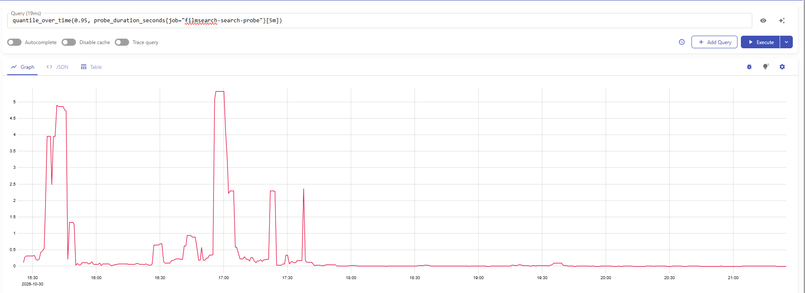
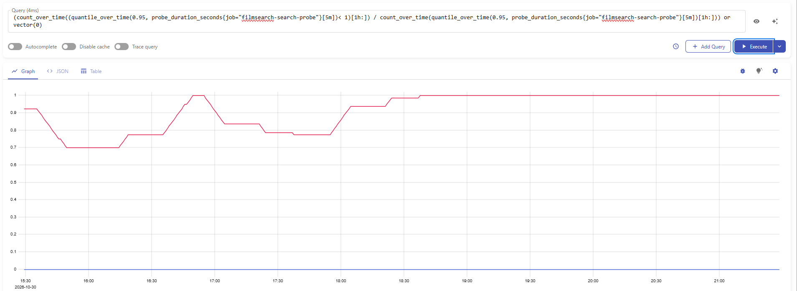
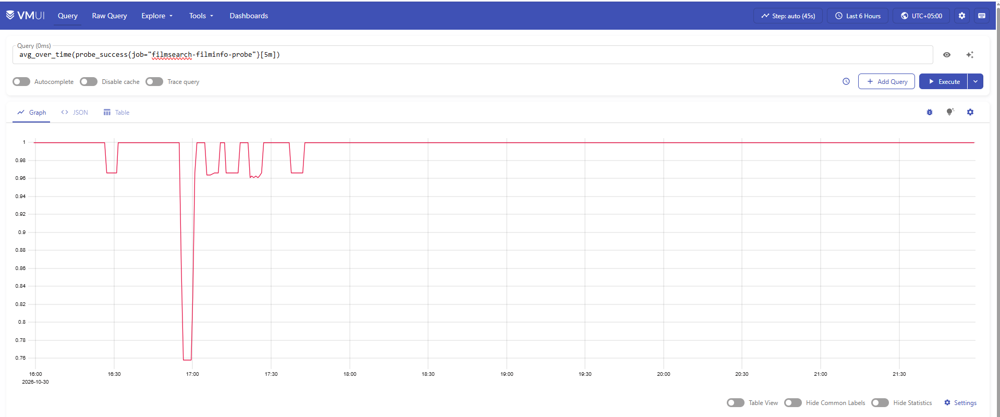
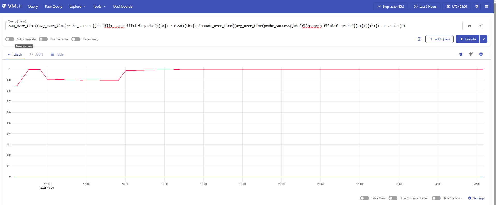

### Пробер
Пробер реализован через phrometeus black-box exporter и доп джобы в скраппере виктории метрикс. Джобы ходят на эндпоинт экспортера /probe, который отправляет запросы на под приложения и кладет результаты в метрики вида "probe_***". Джобы добавляются через extraScrapeConfigs и не вызывают пересоздание пода из-за изменения конфига

### Метрики (не понял что имелось ввиду под изменением поведения приложение, оказывал большую нагурзку на пк для имитации, можоет сойдет)
## Первая метрика - время поиска фильма
# SLI

# SLO
В бд нет данных почти и на реальных кейсах поиск был бы дольше, поэтому пускай значение, к которому будем стремиться - 1 секунда, оно ближе к реальности
# SLA

возьмем 70% 
## Вторая метрика - количество успешных просмотров информации о фильме
# SLI

# SLO
По графику видим, что значительная часть не ниже 1 (доля успешных запросов) да и в целом это основаня фича, которую мы хотим сохранить, так что СЛО можно сделать 0.99
# SLA

Перестрахуемся и возьмем 85% 
## Третья метрика - НЕТ. Остальные метрики и ручки, за них отвечающие, создают ресурсы (фильмы и отзывы), что оказывает влияние на реальных юзеров. Для таких метрик пробер не подойдет, как понял. А чтобы посчитать кол-во успешных добавлений отзывов условно нужно еще лейблу добавить к метрике об успехе или не успехе, чего я не сделал в пред дз. Сейчас уже не успеваю, сижу прям перед дд.