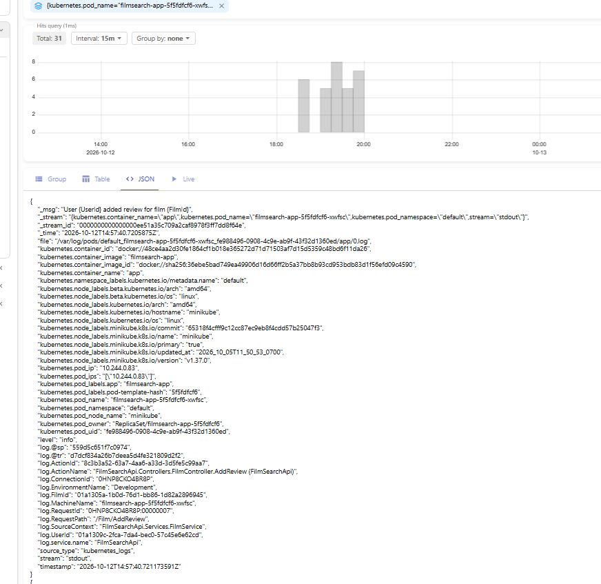
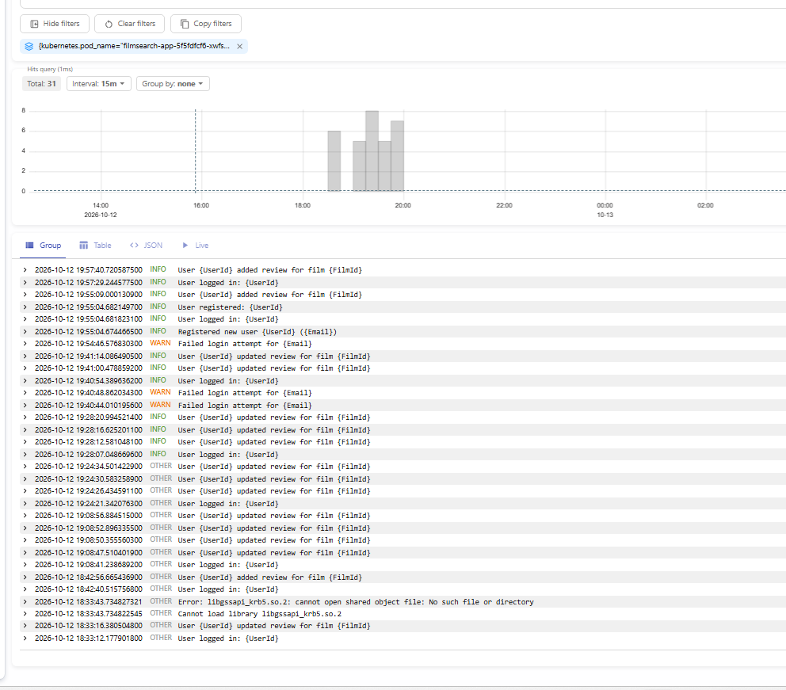
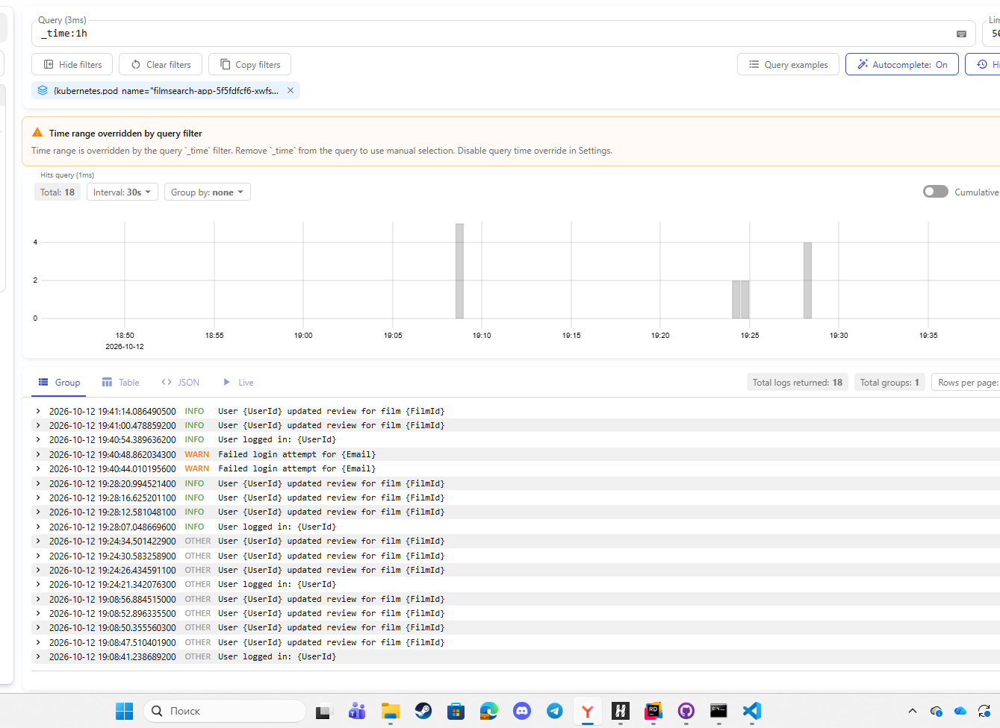
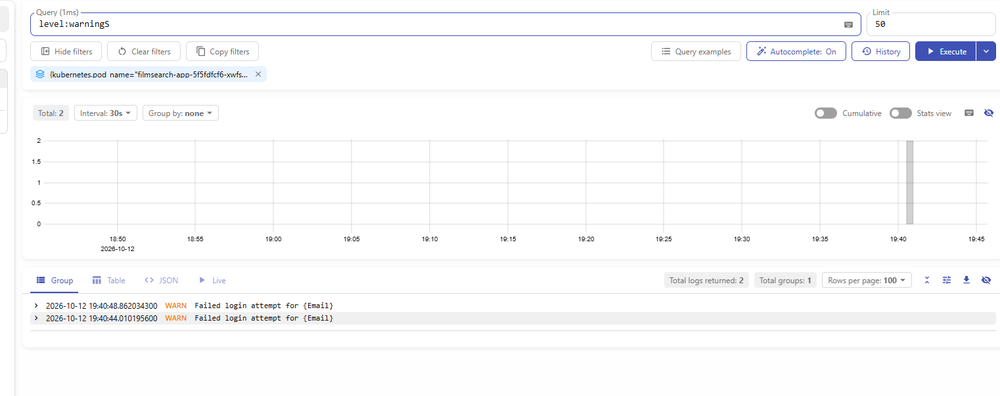
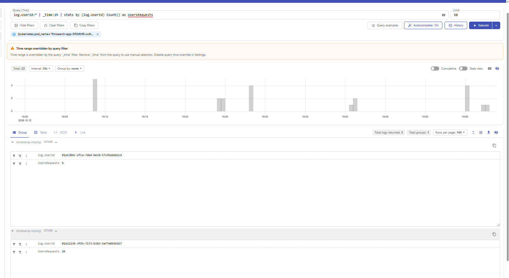
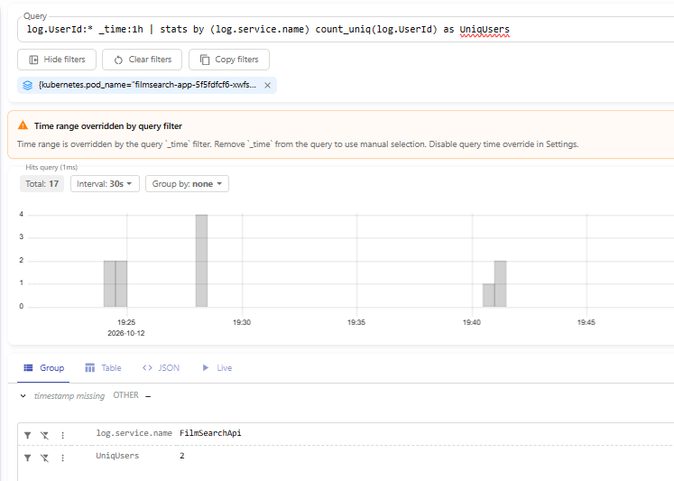

Victoria logs разворачивал через Helm-chart victoria-logs-single, конфиг с values можно найти в папке Manifests. Приложение пишет логи в формате json, у вектора настроен маппинг полей, чтобы в виктории все нормально отображалосью Вот примеры как все выглядит:

1.Логи за последний час

2.Логи, отфильтрованные по уровню warning

3.Статистика - сколько запросов совершали пользователи за последний час

4.Аггрегирующий запрос, показывающий сколько пользователей пользовалось сервисом за последний час
