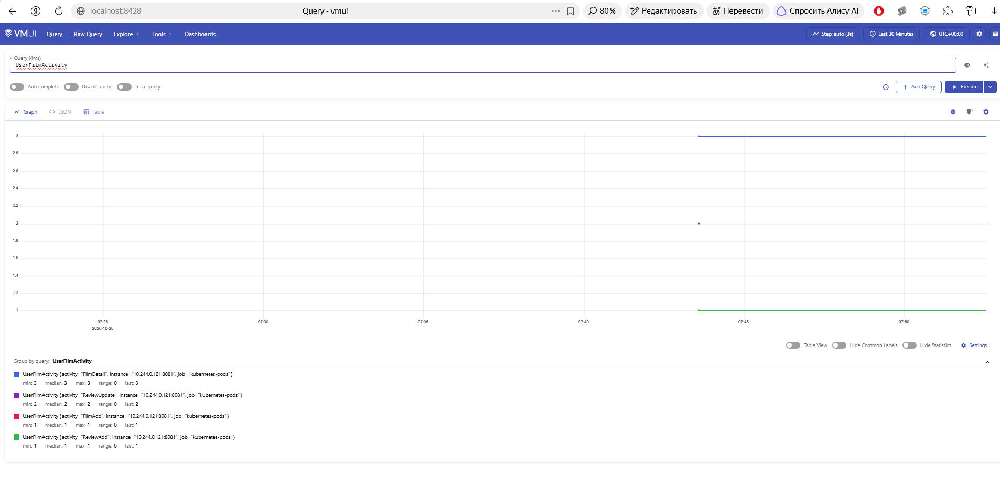
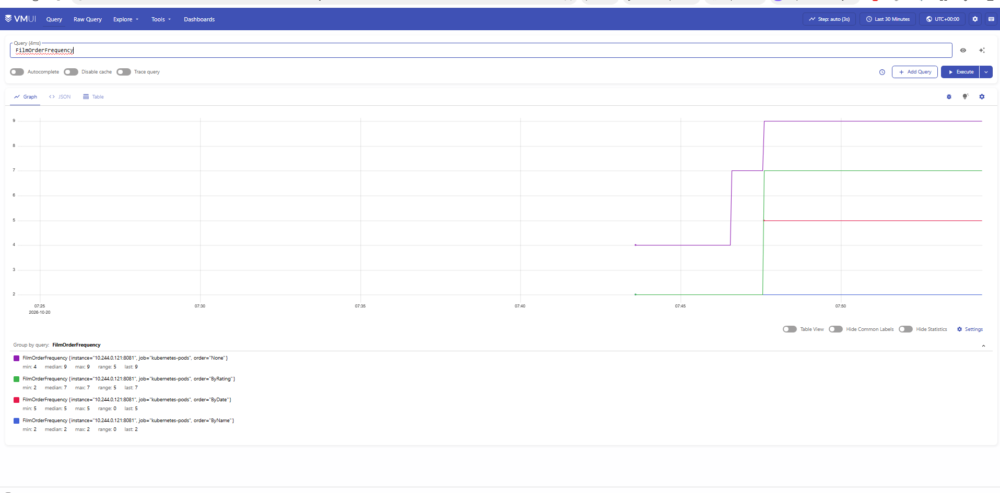
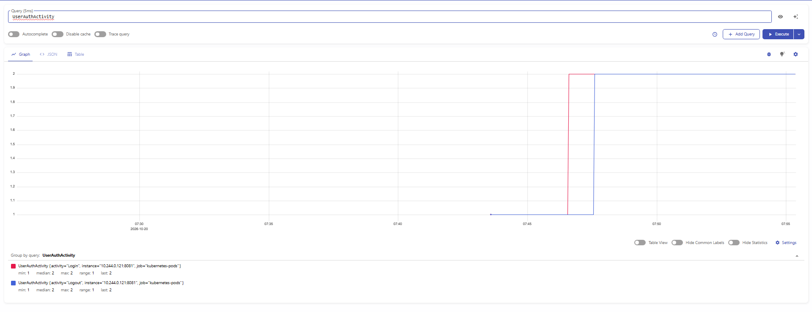
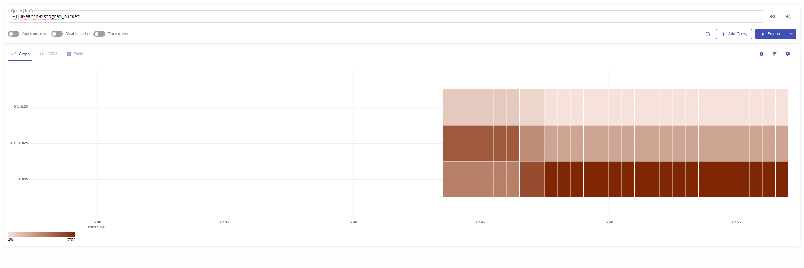
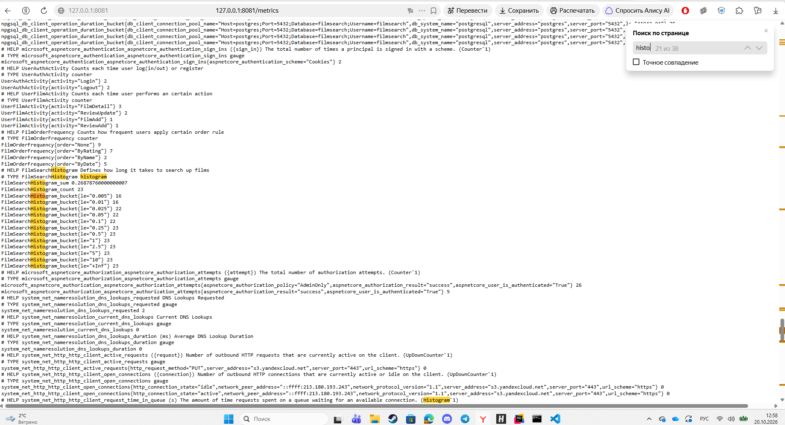
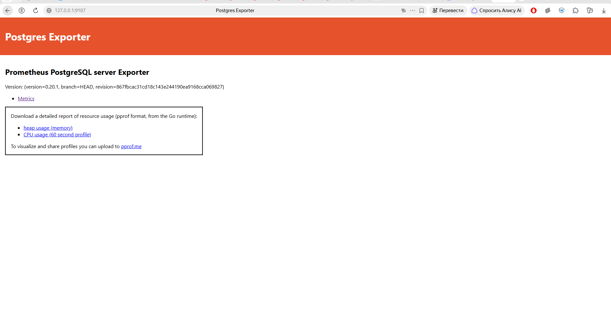
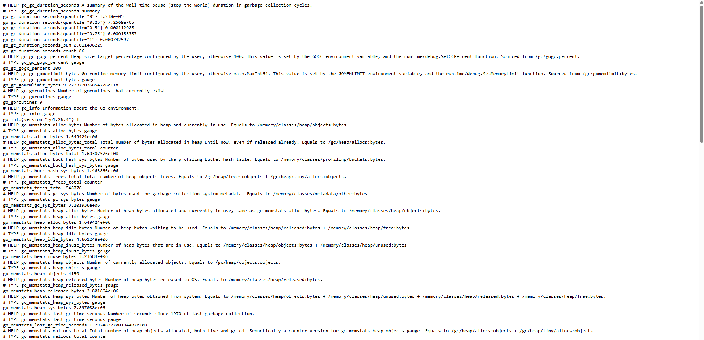
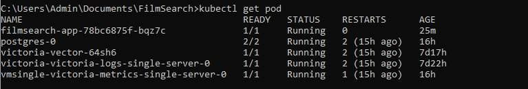
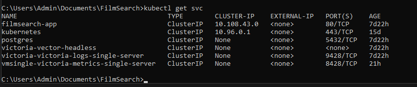
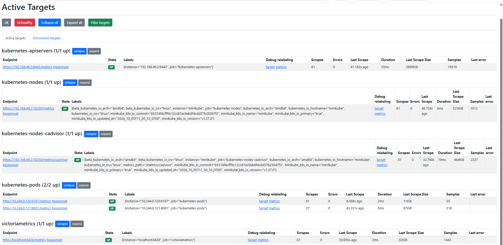

# Как поставил
Установил victoria metrics server через helm, в values из гайда поменял только время скрапа на раз в минуту. Добавил джобу, которая бегает по подам и собирает  метрики в соответствии с аннотациями в метадате (если она вообще есть).

# Бизнес метрики
UserFilmActivity - счетчик по действиям юзеров с фильмами (добавление, удаление, отзывы и тд)

FilmOrderFrequency - счетчик как часто применяется определнный тип сортировки при поиске фильмов

UserAuthActivity - счетчик по действиям юзеров при входе/выходе

FilmSearchHistogram - замеряет как долго ищутся фильмы

# Метри приложения и постгреса по /metrics. И там, и там метрики можно получить только на одном порту, а порты эти не доступны через сервис, так что только инфра имеет доступ к ним

# Артефакты с показом подов и сервисов

 
