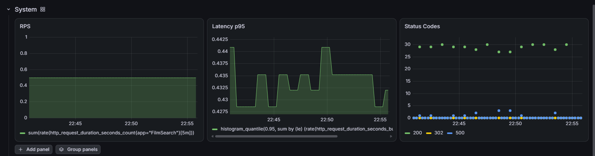
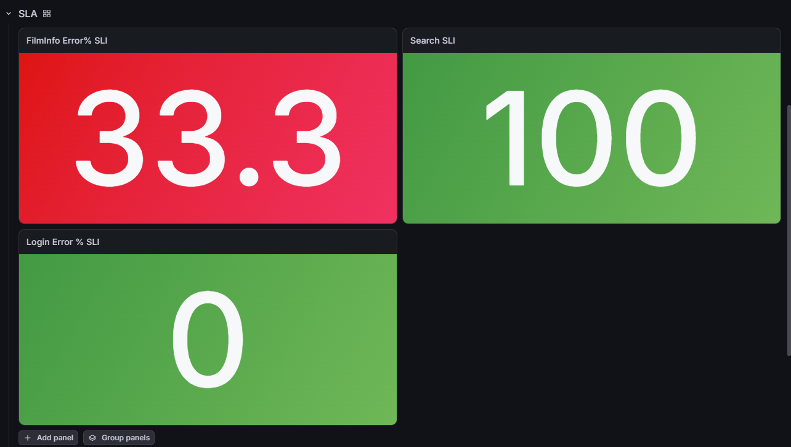
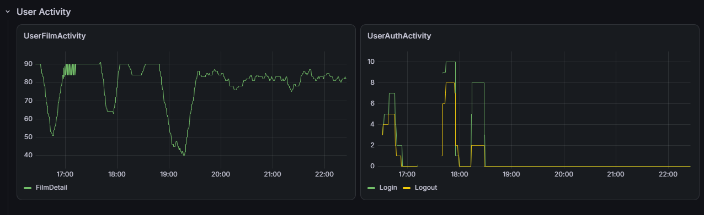

# Системные метрики

# SLA

Выбрал стат, т к по-хорошему изменений здесь быть практически не должно, а для понимания проблемы достаточно текущего значения, то как менялся график не особо что скажет, тут важно уже смотреть на другие метрики. Хотя можно было и Gauge, наверно, для большей наглядности
# Бизнес метрики

Для остального выбрал тайм сирис, т к видна изменчивость метрики, а каких-то специфик и не надо
Сделал именно такие панели, т к они в полной мере отображают доступность приложения. 
Все метрики берутся из Victoria-Metrics. Дашборд для постгрес экспортера скачан с офф сайта. 