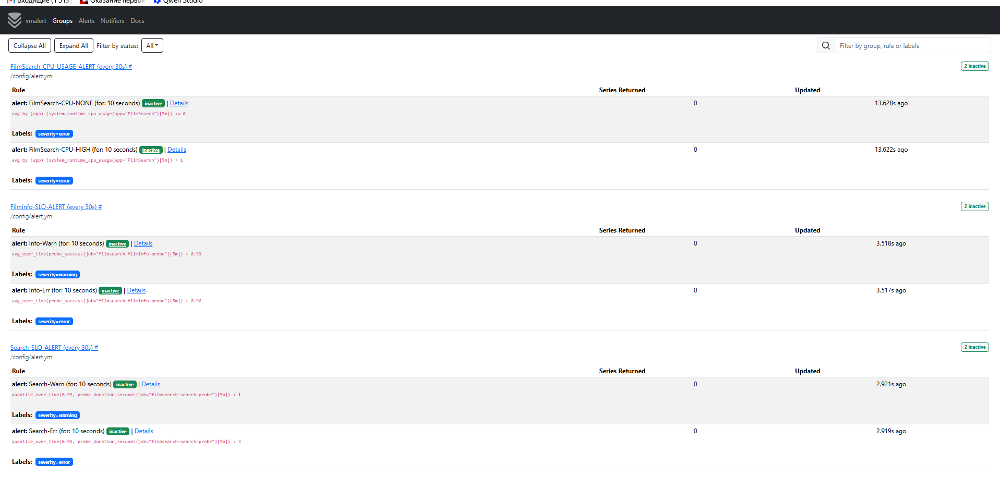
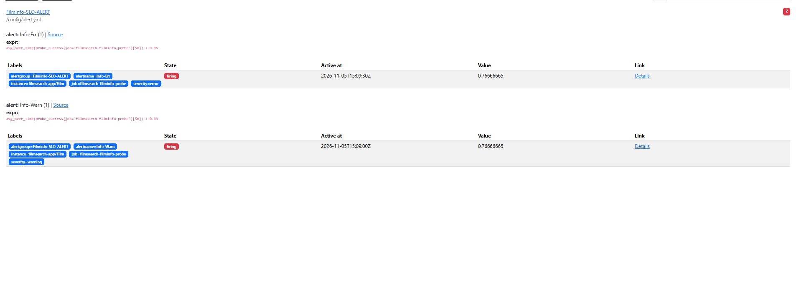
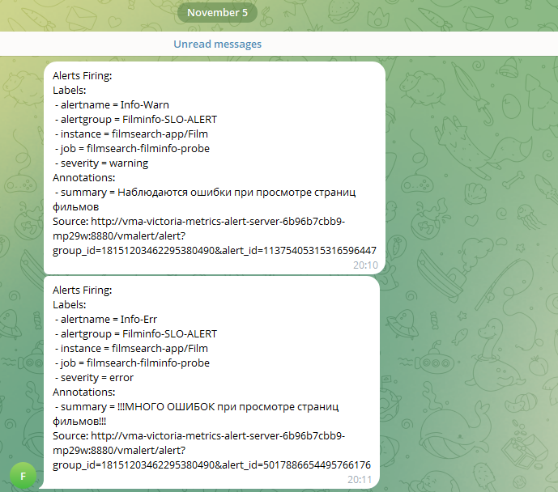
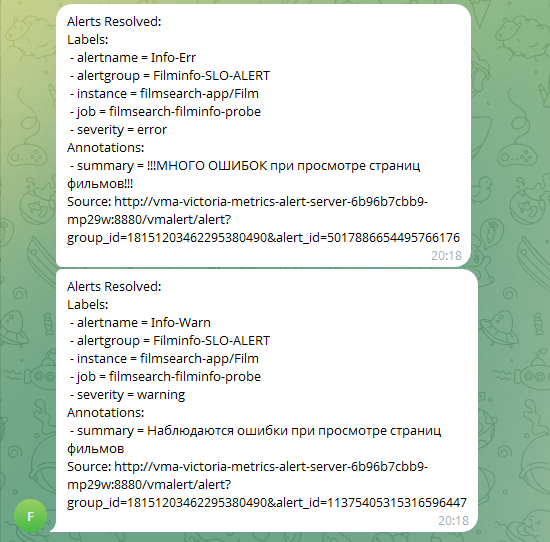
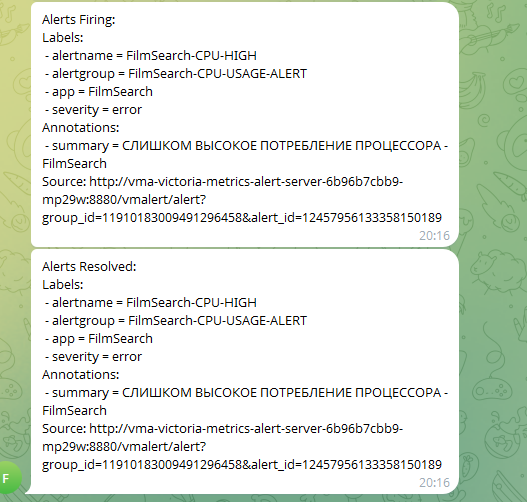

# Группы алертов

# Firing алерты

# Уведы в телеге с алертами

# Уведы, что все вернулось в норму

# Уведы на алерты системных метрик

## На что сами алерты

Есть 3 группы алертров, 2 из них отслеживают метрики, отвечающие за СЛО. Если нарушается СЛО, то отправляется алерт WARN, если уже под угрозой СЛА, то шлется доп алерт ERROR. Это одни из важнейших метрик для бизнеса, поэтому отслеживать их состояние кажется жизненно необходимым. Третья группа на системную метрику. Отслеживает нагрузку CPU, которую вызывает сервис. Алерты стоят на крайние случаи - сервис потребляет очень много или сервис не потребляет вовсе. Это еще одна из проверок, что сервис жив и не задыхается от нагрузки